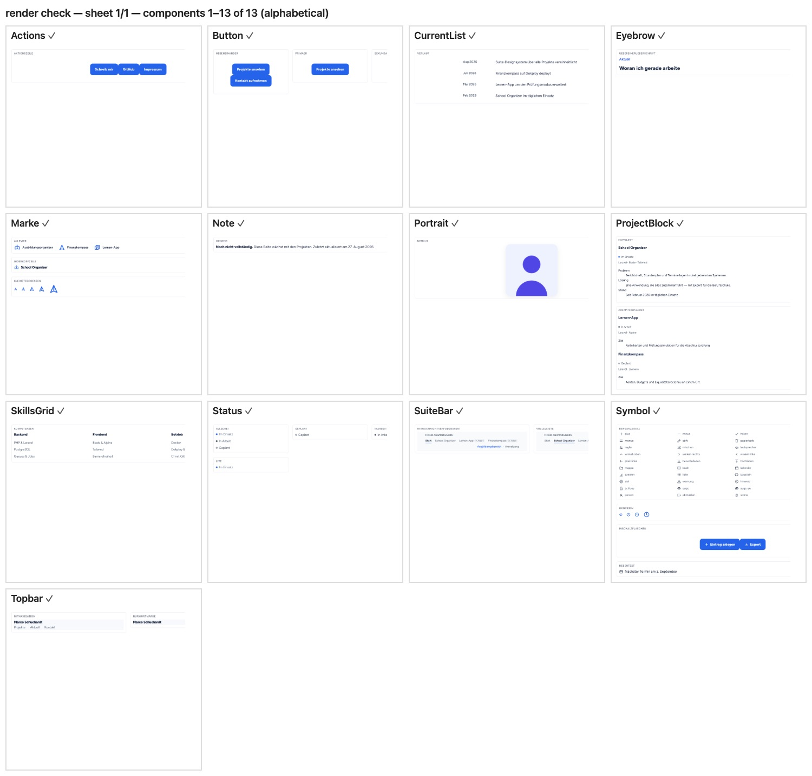

# Suite-Designsystem — Adapter für Claude Design

**Wozu das existiert:** [claude.ai/design](https://claude.ai/design) rendert
ausschließlich React. Die Suite-Anwendungen sind Blade, Alpine und Livewire —
die lassen sich dort nicht direkt einspeisen. Dieses Paket übersetzt.

**Was es nicht ist:** keine gemeinsame Bibliothek für die Anwendungen. Die
können React-Komponenten nicht importieren und werden es nicht tun. Wer im
School Organizer oder in der Lernen-App etwas baut, nimmt die
`--suite-*`-Tokens und Blade — nicht dieses Paket.

## Auf einen Blick

Dreizehn Komponenten, alle mit Vorschau und kurzer Beschreibung:
[docs/komponenten.md](docs/komponenten.md).



## Quelle der Wahrheit ist die Homepage

Das CSS wird **nicht** hier gepflegt. `scripts/sync-css.mjs` holt es bei jedem
Build frisch aus dem Homepage-Repo:

| Ziel | Quelle |
|---|---|
| `src/styles/tokens.css` | `homepage/resources/css/basis.css` |
| `src/styles/components.css` | `homepage/resources/css/startseite.css` |
| `src/styles/suite-nav.css` | `homepage/partials/suite-nav.css` |
| `fonts/` | `homepage/public/fonts/` |

Diese Dateien sind gitignored, weil sie erzeugt werden. **Änderungen am Design
gehören in die Homepage**, nie hierher — eine Kopie hier würde still
auseinanderlaufen, und Claude Design baute dann in einer Farbwelt, die es nicht
mehr gibt.

Fehlt die Quelle, bricht der Build laut ab statt eine alte Kopie
weiterzuverwenden. Liegt das Repo woanders:

```bash
SUITE_HOMEPAGE=/pfad/zu/homepage npm run build
```

## Was hier gepflegt wird

Nur die React-Hüllen um das fremde CSS: `src/components/*.tsx` und `src/index.ts`.
Sie setzen Klassennamen, sonst nichts — keine eigenen Farben, keine eigenen
Abstände.

Dazu die Preview-Beispiele in `.design-sync/previews/` (was auf den Karten in
Claude Design zu sehen ist) und `.design-sync/conventions.md` (landet im
Systemprompt des Design-Agenten).

## Bauen und hochladen

```bash
npm install
npm run build                    # CSS aus der Homepage holen, bündeln, tsc

node .ds-sync/package-build.mjs \
  --config .design-sync/config.json --node-modules node_modules --out ds-bundle
node .ds-sync/package-validate.mjs ds-bundle   # 11/11 müssen sauber rendern
```

Danach hochladen — die Projekt-ID steht in `.design-sync/config.json`.
`.ds-sync/` sind die gestageten Skripte der `/design-sync`-Skill und ebenfalls
gitignored; bei einem frischen Checkout legt die Skill sie neu ab.

## Design-Skills

Unter `skills/` liegen die vier Werkzeuge aus MAR-214, die das Designsystem
beim Bauen durchsetzen statt es nur zu beschreiben: `design-taste`,
`ui-design-intelligence`, `browser-qa` und `design-system-extractor`.

```bash
sh skills/einrichten.sh     # verknuepft nach ~/.claude/skills/
```

Sie liegen hier und nicht nur unter `~/.claude/skills/`, damit sie einen
Rechnerwechsel überleben — MAR-253 beschreibt genau diesen Verlust. Einzelheiten
in `skills/README.md`.

## Bezug

MAR-89 (Designsystem), MAR-254 (Kontraststufe), MAR-90 (Lernen-App
eingegliedert). Das Konzept steht in `school-organizer/DESIGN-SYSTEM.md`.

## Rechte

Alle Rechte vorbehalten. Dieses Repository ist öffentlich einsehbar, steht aber
unter keiner Lizenz: Der Inhalt darf ohne meine Zustimmung nicht kopiert,
verändert oder weiterverwendet werden.

Schriften sind nicht Teil dieses Repositorys. Sie kommen beim Bauen aus dem
Homepage-Repository und behalten ihre eigene Lizenz.
