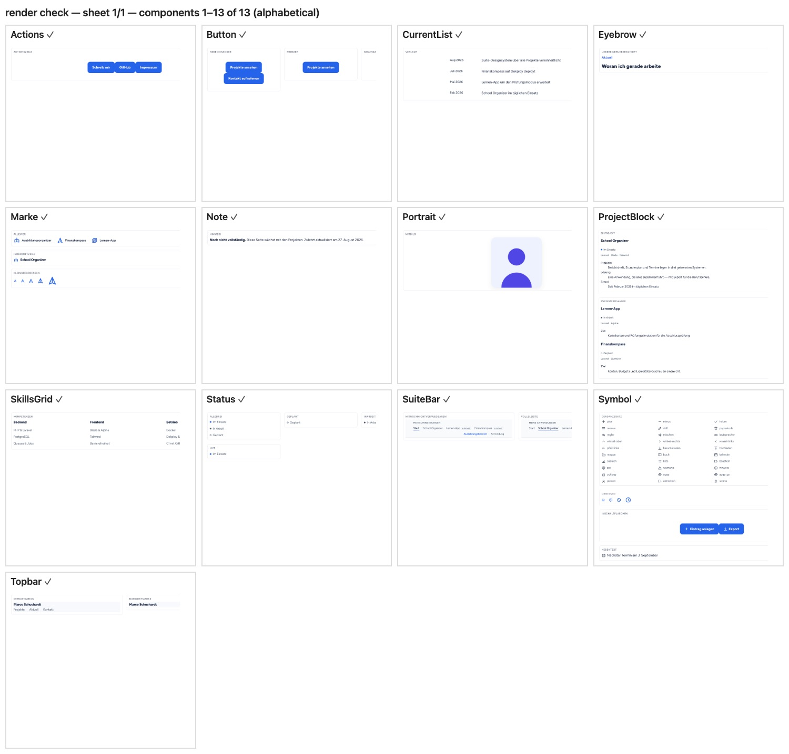

# Komponenten im Überblick

Dreizehn React-Hüllen um das CSS der Homepage. Jede setzt nur Klassennamen;
Farben, Abstände und Schriften kommen aus den `--suite-*`-Tokens.



Das Bild entsteht bei der Render-Prüfung des Pakets (siehe „Bauen und
hochladen“ im README) und zeigt die Beispiele aus `.design-sync/previews/`.

| Komponente | Wofür |
|---|---|
| `Actions` | Zeile aus Buttons. Bricht auf schmalen Bildschirmen um, statt überzulaufen. |
| `Button` | Eine Aktion. Die Primärvariante trägt den einen Akzent der Seite. |
| `CurrentList` | Verlaufsliste mit Zeitspalte; Zahlen stehen tabellarisch untereinander. |
| `Eyebrow` | Kleine Überzeile über einer Überschrift, in Versalien. |
| `Marke` | Das Zeichen einer Suite-Anwendung, in mehreren Größen. |
| `Note` | Hinweisbox für Einschränkungen und Zwischenstände, mit gestricheltem Rahmen. |
| `Portrait` | Quadratisches Bild mit weichem Radius und Rahmen. |
| `ProjectBlock` | Ein Projekt mit Stand, Technik und kurzen Abschnitten, gestapelt statt als Kachel. |
| `SkillsGrid` | Kompetenzraster; die Spalten fließen ab 220 px Mindestbreite von selbst. |
| `Status` | Zustandsanzeige mit Punkt. Der Zustand steht im Text, nicht nur in der Farbe. |
| `SuiteBar` | Leiste mit den Anwendungen der Suite und dem Sprung in den eigenen Bereich. |
| `Symbol` | Ein Symbol aus dem gemeinsamen Satz; übernimmt die Textfarbe und passt in hell wie dunkel. |
| `Topbar` | Kopfzeile: Wortmarke links, Navigation rechts, bricht auf schmal um. |

## Ein Beispiel

```tsx
import { Actions, Button, Eyebrow, Status } from '@suite/design-system';

export function Kopf() {
  return (
    <header>
      <Eyebrow>Aktuell</Eyebrow>
      <h1>Woran ich gerade arbeite</h1>
      <Status state="live">Im Einsatz</Status>
      <Actions>
        <Button href="/projekte">Projekte ansehen</Button>
      </Actions>
    </header>
  );
}
```

Die genauen Eigenschaften stehen in den Typen der jeweiligen Datei unter
`src/components/`; die vollständigen Beispiele liegen in
`.design-sync/previews/`.

## Hell und dunkel

Die Komponenten kennen kein eigenes Thema. Sie folgen den Tokens: Setzt die
Seite `data-theme="dark"` am `<html>`, wechseln alle Farben mit.
